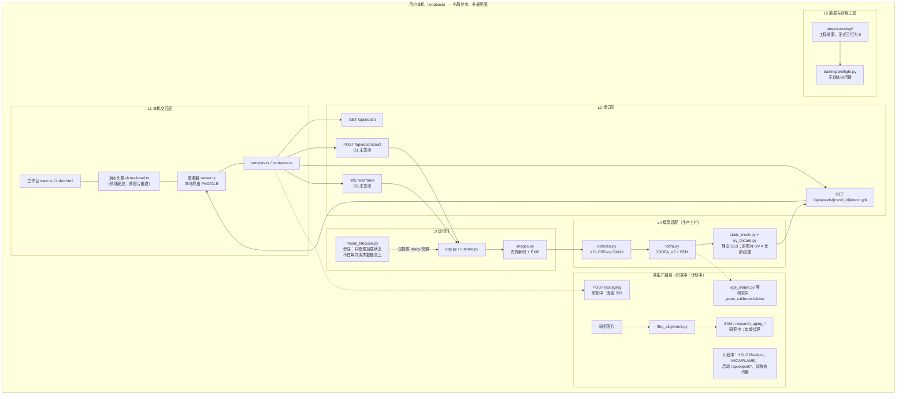
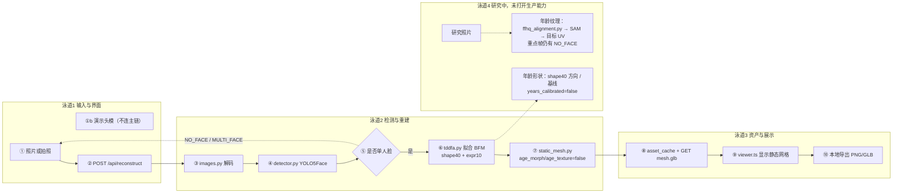

# MU-1 系统架构图与流程图绘制规格

- **任务**：MU-1（`/workspace/AgeMorph3D_后续任务规划_v2.md` 第 127 行）
- **用途**：开题报告、答辩/阶段 PPT 中的系统架构图与端到端流程图。任务书要求图表由学生本人绘制，本文件只给文字规格，**不附成品图，也不应被直接截成插图使用**。
- **依据仓库**：`/workspace/AgeMorph3D`，`main` 分支提交 `35c0cd61b70976393f919dfff34834bad9a67dc8`（提交时间 2026-11-01 12:35 UTC+8，合入 PR #5）。本规格编制于 2026-11-15。
- **主要输入**：`README.md`（目标流程与已实现边界）、`docs/AgeMorph3D_技术框架与模块行动计划.md`（规划中的模块地图，**不能当作已实现清单**）、`ARCHITECTURE.md`、`docs/api.md`（契约 v1.2）、`docs/验收矩阵.md`，以及 `backend/src/agemorph3d/`、`frontend/src/`、`preprocessing/`、`training/`、`tools/` 的实际代码。
- **硬性约束**：
  1. 图中模块、脚本、文件名必须与仓库或文档中的现用名称一致，不以技术框架草案里的计划路径（如 `backend/app/`、`yolo_face.py`、`mica_wrapper.py`）代替现用路径。
  2. 未实现或不在生产路径上的能力，不得画成实线实心的“已交付模块”。年龄纹理、生产年龄形变、YOLO26、MICA/FLAME、后端导出接口等，一律按第 2 节样式标为「研究中」或「计划中」。
  3. 本文中的 Mermaid 源码只供排版时对照布局，**不是最终插图**。

---

## 1. 图件清单与建议图题

建议在开题报告中使用两张主图；PPT 可将同一内容拆到两页，不要把全部细节挤进一张幻灯片。

| 编号 | 建议图题 | 类型 | 回答的问题 |
|---|---|---|---|
| 图 1 | 图 X-1 AgeMorph3D 系统架构（对照仓库现用模块） | 分层架构图 | 前后端、接口、模型适配器、离线研究与数据工具如何分层，哪些已在生产路径上 |
| 图 2 | 图 X-2 AgeMorph3D 端到端处理流程（照片/摄像头 → 检测 → 重建 → 展示；年龄能力单独标示） | 带泳道的流程图 | 一张成人照片或一帧摄像头画面实际经过哪些步骤，年龄形状/纹理走哪条研究分支 |

若版面允许，可在图注（不是另画第三张“能力图”）用一两句话写清：演示头模不是上传照片的重建结果；原照片 UV 不是年龄纹理。

---

## 2. 视觉语言、配色与图例（两图共用）

开题报告多为白底打印，PPT 可为浅色学术页或沿用设计系统的深色视口。**同一套语义色在两种媒介中保持对应关系**，只改变底色和文字对比度。色值取自 `design/设计系统说明.md` 的主色，并为打印补充浅底填充。

### 2.1 共用调色板（请按此 Hex 上色，不要另配绿色）

| 角色 | 色名 | Hex | 用法 |
|---|---|---|---|
| 视口/深底（仅深色 PPT 页） | Ink Viewport | `#0A0E1A` | 深色幻灯片背景，不用于 A4 打印纸面 |
| 面板深色 | Panel | `#111828` | 深色页的模块填充备选 |
| 蚀刻线 / 主描边 | Etch Line | `#233047` | 已实现模块的实线边框、泳道分隔线、坐标框 |
| 主文字（深底） | Readout | `#E9EEF6` | 深色页标题与模块名 |
| 次文字（深底） | Dim Label | `#8B96AC` | 深色页注释、路径、箭头标签 |
| 时间起点 / 前端强调 | Youth Cyan | `#35D3C0` | 前端层边框或细强调条；链接式标注 |
| 时间终点 / 验收提示 | Age Amber | `#E8A04C` | “验收未通过”徽章、年龄轴右端、关键注意标记 |
| 年龄轴渐变（装饰，不作小字底） | Time Gradient | `#35D3C0` → `#E8A04C`（90°，左青右珀） | 仅用于图题装饰条或年龄范围 20—70 的细色带 |
| 打印纸面 | Paper | `#FFFFFF` | A4 / 浅色 PPT 背景 |
| 主文字（浅底） | Ink Text | `#1B2433` | 浅底模块名、图题 |
| 次文字（浅底） | Mute Text | `#5C6B80` | 浅底路径、箭头标签、图注 |
| 前端填充（浅） | Cyan Wash | `#E7F8F5` | 前端工作台模块底 |
| 后端填充（浅） | Slate Wash | `#EEF2F7` | FastAPI / Runtime / 契约模块底 |
| 模型填充（浅） | Steel Wash | `#E4EAF3` | 检测、3DDFA_V2/BFM、静态网格模块底 |
| 研究中填充 | Research Gray | `#E8E8EA` | 研究中模块底（配合虚线边框） |
| 计划中填充 | Plan Gray | `#F4F4F5` | 计划中模块底（配合虚线边框与更浅文字） |
| 研究/计划描边 | Dashed Gray | `#8B96AC` | 虚线边框 |
| 错误/拒绝分支（不用纯红） | Amber Deep | `#C4842A` | NO_FACE / MULTI_FACE / 503 等失败旁路箭头，琥珀色实线或点划线 |
| 工程前置填充 | Preflight Tint | `#F7F4EE` | 预处理/训练预检等“代码有、正式数据没有”的模块，实线细边 |

对比度：浅底上正文用 `#1B2433`（避免用青色或琥珀作小字颜色）。渐变条不得作为小字背景。

### 2.2 模块样式（必须在每张图的图例中画出）

| 状态 | 边框 | 填充 | 文字 | 角标（模块右上或标题后） | 含义（以代码为准，不以愿望为准） |
|---|---|---|---|---|---|
| 已实现（生产路径） | 实线 1.25–1.5 pt，`#233047` | 按层级用 Cyan/Slate/Steel Wash | `#1B2433`，模块名加粗 | 无，或小字路径 | 已在生产应用路径中实现（如 `/api/reconstruct`、YOLO5Face 检测、3DDFA 静态重建、前端本地导出） |
| 已实现，验收未通过 | 同上实线实心 | 同上，左上或标题旁加实心琥珀圆点 `#E8A04C`（直径约 3 mm） | 同上 | 徽章「G1 未签收」或「G2 未签收」 | 代码已接入生产接口，但 `docs/验收矩阵.md` 中对应出口尚未正式签收。图中**可以画出**，不可画成“已验收完成” |
| 研究中 | 虚线 1 pt，`#8B96AC`，线段 4 pt / 间隔 3 pt | `#E8E8EA` | `#5C6B80` | 「研究中」 | 仓库中有研究代码或离线工具，但未打开生产能力（例如 `/api/aging` 固定 503，`age_morph`/`age_texture` 为 false） |
| 计划中 | 虚线 1 pt，`#8B96AC`，线段 2 pt / 间隔 3 pt（比研究中更密或更碎） | `#F4F4F5` | `#8B96AC` | 「计划中」 | 任务书或技术框架中有，代码中不存在或仅有预检草案（如 YOLO26n-face、MICA/FLAME、训练执行器、后端导出路由） |
| 工程前置 | 实线 0.75 pt，`#233047` | `#F7F4EE` | `#1B2433` | 「正式数据未到位」 | `preprocessing/`、`training/preflight.py` 等工具代码已有合成验证，正式 train/validation/test 仍为 0 条 |

演示头模（`frontend/src/demo-head.ts`）必须与真实重建结果分开：可用细斜线底纹（间距 3–4 mm，浅灰 `#D0D5DE`，45°），并在框内写「程序化演示头模，非照片重建」。不要把演示滑块画成已接通的生产年龄模型。

箭头：

- 生产数据流：实线箭头，线宽 1 pt，颜色 `#233047`，箭头为闭合三角。
- 研究数据流：虚线箭头，颜色 `#8B96AC`。
- 失败/拒绝分支：点划线，颜色 `#C4842A`。
- 箭头标签写在线上方或折角外侧，6–8 pt（A4）或 11–12 pt（PPT），不要压住模块框。

### 2.3 字体与字号

不要使用设计稿里的远程 Web 字体作为论文插图依赖（仓库前端运行时也不依赖远程字体）。印刷与 PPT 均用本机字体。

| 用途 | 中文字体（优先顺序） | 西文/数字 | A4 开题报告 | 16:9 PPT |
|---|---|---|---|---|
| 图题 | 黑体 / 微软雅黑 / Source Han Sans SC / Noto Sans SC | 同族或 Calibri | 五号，10.5 pt，加粗 | 20–22 pt，加粗 |
| 模块标题 | 同上，加粗 | 同上 | 8–9 pt | 14–16 pt |
| 路径、接口、文件名 | 同上 | Consolas / Cascadia Mono / JetBrains Mono / 等宽 | 7–7.5 pt | 11–12 pt |
| 箭头标签、徽章 | 同上 | 等宽数字 | 6.5–7.5 pt | 10–12 pt |
| 图例与图注 | 宋体或常规黑体 | 同正文 | 8 pt（图注常为五号或小五） | 12–14 pt |

行距 1.15–1.25。模块名用中文短名，其下一行用等宽字体写仓库路径或接口，例如：

```text
人脸检测
detector.py · YOLO5Face ONNX
```

数字与接口一律等宽，年龄范围写成 `20—70`（用中文破折号或 en-dash，两端不要写成 20-70 的连字符）。

---

## 3. 模块映射表（名称必须与仓库一致）

下表是两张图的唯一命名来源。画图时不要改名，也不要合并成技术框架草案里的 `M1–M9` 目录名（那些是 2026-10-17 的计划编号，与现用包路径不一致；若开题正文要对照任务书模块，只在图注写“对应任务书检测/重建/年龄方向”，不要在框内写不存在的文件名）。

### 3.1 前端（`frontend/`）

| 图中名称 | 仓库路径 | 状态 | 核对依据 |
|---|---|---|---|
| 工作台入口 | `frontend/src/main.ts`、`frontend/index.html`、`frontend/src/style.css` | 已实现 | `README.md` 目录节。提交 `10f1918`（2026-11-20）起标记改在 `index.html`，`layout.ts` 已删除；桌面为不滚动单屏三栏 |
| 契约类型 | `frontend/src/contracts.ts` | 已实现 | 与 `docs/api.md` v1.2 字段对应 |
| 本地服务封装 | `frontend/src/services.ts`（`LocalApi`、`CameraController`、`FrameStream`） | 已实现 | 调用 `/api/health`、`/api/reconstruct`、`/api/aging`、`/ws/frame`、`/api/assets/{mesh_id}/mesh.glb` |
| 年龄插值（仅演示/资产约定） | `frontend/src/age.ts`（`getAgeWeights`，锚点 `age_20`/`age_45`/`age_70`） | 已实现（映射函数）；**不代表生产年龄模型已就绪** | 函数存在；生产结果 `asset_mode=static` 时界面应禁用年龄控件（`docs/api.md`） |
| 程序化演示头模 | `frontend/src/demo-head.ts` | 已实现，须加斜线底纹 | `README.md`：演示模型不是上传照片的重建结果，也不是对个人未来容貌的预测 |
| 三维查看器与本地导出 | `frontend/src/viewer.ts`（`FaceViewer.exportGLB` / `exportPNG`） | 已实现 | Three.js `OrbitControls`、`GLTFExporter`；导出在浏览器本地完成 |
| 实时叠加辅助 | `frontend/src/realtime.ts` | 已实现（代码）；G2 未签收 | 与 `FrameStream` 配合画框/五点 |
| 研究会话 / 纹理 / 遮罩 / 质量评审页 | `frontend/src/research-session.ts`、`research-texture.ts`、`research-mask-editor.ts`、`research-mask-draft.ts`、`research-quality-review.ts`、`research-rgba.ts`；页面 `frontend/research/session.html`、`mask-editor.html` 等 | **研究中** | 独立研究页，不作为生产工作台的已交付能力 |
| 前端构建 | `frontend/package.json`、Vite、Three.js | 已实现 | `README.md`：Node 22.18+，无 React/Vue |

### 3.2 本机入口与后端生产路径（`tools/`、`backend/src/agemorph3d/`）

| 图中名称 | 仓库路径 | 状态 | 核对依据 |
|---|---|---|---|
| 本机统一入口 | `tools/local_run.py`（Windows 另有 `tools/local-run.ps1`） | 已实现 | 开发：后端 `127.0.0.1:8000` + Vite `127.0.0.1:5173`；生产：前端静态 `127.0.0.1:4173`，API 仍在 8000。入口本身不授予模型 ready |
| FastAPI 应用 | `backend/src/agemorph3d/app.py` | 已实现 | 现用包名是 `agemorph3d`，不是技术框架中的 `backend/app/` |
| 健康检查 | `GET /api/health`（`app.py`，`runtime.health`） | 已实现 | 返回 `api_version: "1.2"`、`models`、`capabilities`。HTTP 200 不等于推理可用 |
| 静态重建接口 | `POST /api/reconstruct` | 已实现（代码）；**G1 未签收** | 成功路径可返回静态 GLB；验收矩阵 G1 未通过 |
| 网格资产 | `GET /api/assets/{mesh_id}/mesh.glb` | 已实现 | 进程内缓存，不挂载目录；TTL 1800 s 等边界见 `docs/api.md` |
| 实时帧通道 | `WS /ws/frame`（`frame_socket.py` + `realtime.py`；姿态 R 经 `tddfa.py` 投影提取） | 已实现（代码）；**G2 未签收** | `infer_realtime` 先用 `detector.py` 检出框与 5 点，再调用重建器（`tddfa.py` 的 `reconstruct`）取 3DDFA 投影，由 `projection_rotation` 得到纯旋转 R（`realtime.py` 约第 33、51、77–80 行）。回包仅 `bbox`、5 点、`pose.R`、`conf`，**不传 `shape`/`expr`，不生成 GLB**。与技术框架草案的 WS 载荷不同 |
| 年龄接口 | `POST /api/aging`（`app.py` 中直接 `raise model_not_ready()`） | **研究中**（端点存在但生产关闭） | 固定 503 `MODEL_NOT_READY`。不得画成已开通的年龄服务 |
| 后端导出接口 | `POST /api/export/gltf`、`POST /api/export/image` | **计划中** | `docs/api.md` 写明“后端导出预留，尚未实现”；前端已有本地导出，不要画成后端已提供文件流 |
| 运行时 | `runtime.py` | 已实现 | `capabilities` 仅在检测+重建均 `ready` 且服务未关闭时置 `reconstruction=true`、`realtime=true`；年龄两项默认 false，代码未赋 true |
| 模型生命周期 | `model_lifecycle.py`、`model_assets.py`、`model_diagnostics.py`、`model_probe.py` | 已实现 | 可配置并加载的只有 `detector`、`reconstructor`。`age_shape`、`age_texture` 在生命周期中写死为 `missing`（“尚未接入…”） |
| 配置与契约 | `config.py`、`schemas.py`、`middleware.py`、`errors.py` | 已实现 | `Capabilities` 含 `reconstruction` / `age_morph` / `age_texture` / `realtime`，后两项默认 false |
| 图像解码 | `images.py` | 已实现 | 有界内存解码，纠正 EXIF；不写磁盘 |
| 人脸检测 | `detector.py`；清单 `backend/model-manifests/yolov5n05-face.research.json` | 已实现（代码）；随 G1 徽章 | **实际模型是 YOLO5Face ONNX**（`yolov5n-0.5-face.onnx`，`backend`: `yolov5_face_onnx`，输出框 + 5 关键点）。不是任务书/技术框架中的 YOLO26n-face |
| 三维拟合 | `tddfa.py`、`prepare_tddfa.py`；清单 `backend/model-manifests/3ddfa-v2.research.json` | 已实现（代码）；随 G1 徽章 | 3DDFA_V2 ONNX + 裁剪 BFM（`mb1_120x120.onnx`、`bfm.npz`）。输出身份 40 维、表情 10 维，网格 38,365 顶点、76,073 面 |
| 静态重建编排 | `reconstruction.py`（`reconstruct_static`） | 已实现（代码）；随 G1 徽章 | 要求恰好一张人脸；结果 `asset_mode="static"`，`capabilities.age_morph=false`，`age_texture=false` |
| Canonical 静态网格 / GLB 编码 | `static_mesh.py` | 已实现 | 右手 Y-up、正面 +Z；按源网格 bbox 高度归一化到 1；无年龄 morph 目标；非人体米制标定 |
| 原照片 UV 投影 | `uv_texture.py`（`project_photo_texture`） | 已实现（可选，取决于清单是否配置 `uv` 角色） | **这是原照片可见面部的投影，不是年龄纹理**。即使有贴图，结果仍为 static，`texture_url=null`，`age_texture=false` |
| 内存资产缓存 | `asset_cache.py` | 已实现 | 有界 TTL/容量/租约；取消或断开不发布迟到结果 |

### 3.3 研究中（不得画进生产主链的实心框）

| 图中名称 | 仓库路径 | 状态 | 核对依据 |
|---|---|---|---|
| 年龄形状（BFM 属性强度，未年尺度校准） | `age_shape.py`、`prepare_bfm_age.py`、`age_geometry.py`、`age_continuity.py`、`age_statistics.py`、`age_routes.py` | **研究中** | 模块声明独立于生产就绪；`AgeDirection.years_calibrated` 必须为 `False`；生产仍 `static_fallback`（验收矩阵 G3 年龄形状） |
| 形状 40 维特征与方向基线 | `preprocessing/age_features.py`、`preprocessing/age_shape_baseline.py`、`tools/age_shape_baseline.py`、`tools/age_shape_mesh_probe.py` | **研究中** | K1/K2 离线研究；明确“不接入生产 runtime”；K2 记录形状变化微弱，未选定生产路线 |
| 年龄纹理 / SAM 研究链 | `sam_worker.py`、`research_aging_pipeline.py`、`research_aging_service.py`、`research_aging_app.py`、`aging_sessions.py`、`target_uv.py`、`ffhq_alignment.py`；工具 `tools/sam_worker.py`、`tools/research_aging_server.py` | **研究中** | 隔离研究协议；加载成功仍为研究态、`service_ready=false`。生成 PNG 不是生产 UV 年龄纹理。重点 32 帧仍为 `NO_FACE`，人工质量未签收 |
| G3 验收器 | `g3_acceptance.py` | **研究中** | 源码写明 `production_enabled: False`，不授权生产请求 |
| 纹理质量离线评审 | `tools/texture_quality_review.py`、`tools/texture_quality_review_editor.py` | **研究中** | K4 工程工具；真实人工评审未做 |
| 独立评价探针（年龄/身份） | `evaluation_metrics.py`；`tools/age_calibration_probe.py`、`tools/identity_calibration_probe.py` 等 | **研究中** / 非正式评测 | 代码存在，E03/E04 正式评测未开始；不可画成已交付的 MiVOLO/ArcFace 生产模块 |

### 3.4 工程前置与计划中

| 图中名称 | 仓库路径 | 状态 | 核对依据 |
|---|---|---|---|
| 数据取得 / 归档 / 坐标 / 去重 / 划分预检 / 特征对接 / 质检 | `preprocessing/resource_acquisition.py`、`archive_preparation.py`、`annotation_transform.py`、`duplicate_screening.py`、`dataset_manifest.py`、`split_freeze.py`、`feature_join.py`、`data_quality.py` | 工程前置 | 工具与合成验证已有；`README.md` / 验收矩阵：正式三组 0 条，WIDER / AFLW2000-3D / AgeDB 尚未取得 |
| 训练入口预检 | `training/preflight.py`、`training/baseline-draft-v1.json` | 工程前置 + **计划中**（训练本身） | 只读预检，无训练执行器、不读测试评分；T01 真实预检 blocked、23 条缺项；T02/T04 未启动 |
| YOLO26n-face / ultralytics 检测主线 | 技术框架 §1.3；任务书表述见 `docs/毕业设计要求与交付清单.md` | **计划中**（图中不要替代现用检测模块） | **代码实际使用 YOLO5Face**。选型偏差须在开题中向导师说明，但架构图主框必须写 YOLO5Face |
| MICA + FLAME 重建主线 | 技术框架 §1.2、§4.4 的 `mica_wrapper.py` | **计划中** | 源码树中无 MICA/FLAME 实现；当前只完成 3DDFA_V2 + BFM 保底路线 |
| 训练脚本与实验目录 | 技术框架中的 `training/yolo/`、`training/aging/regress_age_direction.py`、`experiments/` | **计划中** | 这些目录/脚本在当前仓库中不存在 |
| 复现检查 / 行数统计 | `tools/repro_check.py`、`tools/code_stats.py` | 已实现（工具，不必画进主架构，可放图注或附录小框） | 不改变产品行为 |

---

## 4. 图 1 系统架构图规格

### 4.1 画幅与布局总则

- **方向**：自上而下的分层架构，左主右辅。主栏是生产路径，右栏是研究中/计划中，用一条竖直虚线隔开，右栏标题写「非生产路径」。
- **分组（由上到下五层，层与层之间留 8–12 mm 空隙，层名写在左侧竖排或每层左上角小字）**：
  1. 本机交互层（浏览器工作台）
  2. 本机入口与接口层（端口与 HTTP/WS）
  3. 后端运行时与生命周期
  4. 模型适配与资产（检测、重建、网格、缓存）
  5. 底栏：数据与训练工具（工程前置 / 计划中）
- **不要**画云端、远程推理或把数据画出“本机”框。可在最外层画一个浅色总框，标题为「用户本机（loopback，数据不出本机）」。
- 层名用小标签，不要用技术框架的 `M0–M9` 作为层标题。

### 4.2 各层模块（相对位置）

**最外框**：`用户本机`。内含下列各层。

**第 1 层（顶，横向排列，前端色 `#E7F8F5`）**，从左到右：

1. 工作台入口（`main.ts` / `index.html`；`layout.ts` 已于 `10f1918` 删除）
2. 程序化演示头模（`demo-head.ts`，斜线底纹 + 说明「非照片重建」）→ 右侧连到 年龄插值 `age.ts`（实线，标签「仅演示网格 / 若未来资产为 age_morph」）
3. 三维查看器 `viewer.ts`（本地导出 PNG / GLB）
4. 本地服务封装 `services.ts` + `contracts.ts` + `realtime.ts`

第 1 层右栏（虚线框，研究中）：研究会话 / 遮罩 / 纹理质量页（合并为一个框即可，内列主要文件名，不要每个研究脚本单独占一格，以免主图过载）。

**第 2 层**：

- 左侧小框：本机入口 `tools/local_run.py`（标注端口：API `http://127.0.0.1:8000`，开发页 `5173`，生产静态页 `4173`）。
- 中部接口条，四个并排小框：
  - `GET /api/health`（实心）
  - `POST /api/reconstruct`（实心 + 琥珀点「G1 未签收」）
  - `GET /api/assets/{mesh_id}/mesh.glb`（实心）
  - `WS /ws/frame`（实心 + 琥珀点「G2 未签收」）
- 右栏两个虚线框：
  - `POST /api/aging`「研究中 / 固定 503 MODEL_NOT_READY」
  - `POST /api/export/gltf` 与 `POST /api/export/image`「计划中（前端已本地导出）」

**第 3 层（后端色 `#EEF2F7`）**，从左到右：

- `app.py`（FastAPI）与 `runtime.py`：每次请求的实际入口，二者画在数据流主轴上。
- `images.py`：有界解码 + EXIF，位于 `/api/reconstruct` 与 `/ws/frame` 的请求数据路径上（`runtime.prepare_static` / `process_frame`），不要省略。
- `model_lifecycle.py`：**旁注**，只管理 detector / reconstructor 的加载状态（age_shape、age_texture 为 missing），**不在每次请求的数据流上**。可用细虚线标「提供 ready 快照」，不要串在 RECON → DET 的主箭头里。
- `schemas.py` / `asset_cache.py` 可收成一个“契约与有界资源”框，内列文件名。

**第 4 层（模型色 `#E4EAF3`）**，主栏从左到右三块，块间实线箭头：

1. **人脸检测** `detector.py`  
   第二行：`YOLO5Face` · `yolov5n-0.5-face.onnx`  
   第三行：框 + 5 点（左眼、右眼、鼻尖、左嘴角、右嘴角）
2. **三维拟合** `tddfa.py`  
   第二行：`3DDFA_V2` + BFM · `mb1_120x120.onnx`  
   第三行：shape40 + expr10
3. **静态网格与可选原照片 UV** `reconstruction.py` + `static_mesh.py` + `uv_texture.py`  
   第二行：canonical 网格，38,365 顶点  
   第三行：无年龄 morph；原照片 UV ≠ 年龄纹理

第 4 层右栏（虚线，研究中），上下两个框：

- 年龄形状研究：`age_shape.py` 等，标注 `years_calibrated=false`，单位 `bfm_attribute_strength`，不是日历年龄生产模型
- 年龄纹理研究：SAM `sam_worker.py` + `research_aging_pipeline.py` + `target_uv.py`，标注「隔离进程 / 未打开 production 能力」

右栏两个研究框的虚线入口不同，**都不要**接到第 2 层的生产 `/api/aging` 实心路径（该接口是关闭的）：

- 年龄形状：从第 4 层主栏的拟合结果 / shape40 研究特征伸出。
- 年龄纹理：从独立的「研究照片」节点伸出，先经过 `ffhq_alignment.py` 对齐，再进入 SAM / `research_aging_pipeline.py`。这条链的输入是源照片，**不是**生产静态网格或已发布的 GLB（不要画成 MESH → TEX）。

若一定要表示“将来拟接入”生产年龄接口，用极细灰色虚线并加标签「未接线，计划视 G3 而定」，不可画成已连通。

**第 5 层（底栏，全宽）**：

- 左：预处理工具箱（工程前置样式），一个框内列出 `preprocessing/*.py` 的短名（取得、归档、坐标、清单、去重、划分预检、特征对接、质检、shape40 特征）。标注「正式 train/validation/test = 0」。
- 中：`training/preflight.py`（工程前置 + 训练「计划中」），标注「无训练执行器」。
- 右：计划中小框，标题「任务书/技术框架中尚未落地（勿当作现系统）」：`YOLO26n-face`、`MICA+FLAME`、`training/yolo/`、`experiments/`。这三个名字**只出现在此虚线框**，不要出现在第 4 层主栏。

### 4.3 图 1 的箭头与标签

| 起点 | 终点 | 线型 | 标签 |
|---|---|---|---|
| 工作台 / `services.ts` | `GET /api/health` | 实线 | 查询模型状态与 capabilities |
| 工作台（用户选照片或拍照） | `POST /api/reconstruct` | 实线 | `multipart`：`image`，可选 `source_age`（20—70） |
| `POST /api/reconstruct` | `runtime.py` → `images.py` | 实线 | 有界解码 + EXIF |
| `runtime.py` | `detector.py` | 实线 | `detect` |
| `detector.py` | `tddfa.py` | 实线 | 单人脸 bbox |
| `tddfa.py` | `reconstruction.py` / `static_mesh.py` | 实线 | 原始 BFM 几何 → canonical GLB |
| `static_mesh.py` | `asset_cache.py` → `GET .../mesh.glb` | 实线 | 内存发布 `mesh_id` |
| `GET .../mesh.glb` | `viewer.ts` | 实线 | 自包含 GLB（static，无 morph 目标） |
| `viewer.ts` | 本地文件 | 实线 | 浏览器导出 PNG / GLB（非后端 `/api/export/*`） |
| 摄像头预览 | `WS /ws/frame` | 实线 | JPEG 帧，最长边 ≤ 640，上限 10 FPS |
| `WS /ws/frame` | `runtime.py` → `images.py` → `realtime.py`（`detector.py` + `tddfa.py`） | 实线 | `infer_realtime` 用 3DDFA 投影计算姿态 R；回 `face_state`：框、5 点、R；不更新网格身份、不生成 GLB |
| `WS /ws/frame` | 工作台叠加 | 实线 | 画框 / 五点 / 姿态 |
| 工作台若调用 | `POST /api/aging` | 虚线 | 标签必须写「503 MODEL_NOT_READY」 |
| 拟合或离线特征 | 年龄形状研究框 | 虚线 | 形状参数空间中的方向研究 |
| 研究照片 | `ffhq_alignment.py` → 年龄纹理研究框（SAM / `research_aging_pipeline.py`） | 虚线 | 源照片先对齐，再生成目标年龄图像并做目标 UV（研究）；不从静态网格出发 |
| 预处理工具箱 | 训练预检 | 细实线 | 只读账本，不启动训练 |

失败旁路（琥珀色点划线，可画在主箭头下方的小分支，不要另占一层）：

- 检测 0 张人脸 → 422 `NO_FACE`（HTTP 与 WS 均可恢复）
- 检测多于 1 张 → 422 `MULTI_FACE`（HTTP 与 WS 均可恢复）
- 模型未 ready → 503 / `MODEL_NOT_READY`（WS 关码 1013）
- 资产过期或不存在 → 404 `ASSET_NOT_FOUND`（仅静态资产读取）
- 实时通道另需画出（见 `docs/api.md` 约第 129 行、`frame_socket.py`、`realtime.py`）：`BUSY`（工作线程被占用或未等回复就连发第二帧，可恢复）；`TIMEOUT`（处理超时，关码 1013）；`POSE_FAILED`（3DDFA 投影/姿态计算等失败，脱敏，关码 1011）

### 4.4 图 1 图例与图注（必须抄在图下）

图例按第 2.2 节五种状态 + 演示头模底纹 + 三种箭头，各画一个 8–12 mm 宽的示意矩形。

建议图注（可压缩为 3–4 句，但不得删掉第 2、3 点）：

1. 本图按仓库提交 `35c0cd6` 的现用模块绘制，不以 2026-10-17 技术框架草案中的目录或 YOLO26/MICA 作为已实现架构。
2. 生产年龄能力未打开：`/api/aging` 返回 503，`age_morph` 与 `age_texture` 为 false；图中灰色虚线模块为研究中或计划中。
3. 检测现用 YOLO5Face，重建现用 3DDFA_V2 + BFM。任务书中的 YOLO26n-face 与 MICA/FLAME 仅出现在「计划中」框。
4. 静态链路与实时链路的代码已接入，但 G1、G2 尚未正式签收（琥珀标记）。
5. 人脸数据只在本机 loopback 处理。

### 4.5 布局参考（Mermaid，仅供对照，不是最终图）

下面源码用于在编辑器里检查层次和箭头方向，**请勿截图贴进开题报告或 PPT**。最终图须按第 2 节配色与线型手绘或用 Visio / PowerPoint / draw.io 另排，并加上本规格要求的虚线样式与徽章（Mermaid 无法准确表达全部线型与色值）。



`/ws/frame` 同样经 `runtime.py` 与 `images.py`，再进入 `infer_realtime`（`detector.py` + `tddfa.py` 投影求 R），不进入 `static_mesh.py` 或资产缓存。上图为免交叉只把 WS 接到 APP，最终手绘图须画出这条与静态链在网格编码之前分开的支路。

---

## 5. 图 2 端到端流程图规格

### 5.1 画幅与泳道

- **方向**：从左到右的主流程；纵向用四条泳道（也可用四条水平色带）。不要画成环形“产品愿景图”。
- **泳道（自上而下）**：
  1. **输入与界面**（前端色）
  2. **检测与重建（生产路径）**（模型色）
  3. **资产、展示与导出**（后端/前端色）
  4. **年龄研究分支**（灰色虚线泳道，整条泳道底用 `#F4F4F5`，标题写「研究中，未打开生产能力」）
- 主流程只走第 1–3 泳道。第 4 泳道里，年龄形状用虚线从“已得到 shape40”引出；年龄纹理用虚线从独立的“研究照片”引出（先 `ffhq_alignment.py`），**不要**从静态网格引出。分叉处写「不进入 /api/aging」。

若 PPT 一页过挤：页 A 只画第 1–3 泳道（开题主流程），页 B 单独画第 4 泳道，并在页 A 右下角用虚线框写“年龄形状 / 年龄纹理见下页（研究中）”。

### 5.2 主流程步骤（实心，从左到右）

按时间顺序布置，步骤编号 ①—⑩ 写在框的左上角。框内第一行中文，第二行路径或接口。

| 序号 | 泳道 | 框内文字 | 路径/接口 | 样式 |
|---|---|---|---|---|
| ① | 输入 | 选择本地照片，或摄像头预览后拍照 | `services.ts` `CameraController`；拍照上传最长边 1280 | 实心。选入照片本身不等于已检测/重建，可在箭头上标注这一句 |
| ①b | 输入（① 上方的并行小框） | 演示模式：程序化头模，滑块 20—70 | `demo-head.ts` + `age.ts` | 斜线底纹；**不连到②**，单独标注「不经过检测/重建」 |
| ② | 输入 → 接口 | 上传至本地服务 | `POST /api/reconstruct`（`image`，可选 `source_age`） | 实心 + G1 徽章 |
| ③ | 检测与重建 | 有界解码，纠正 EXIF | `images.py` | 实心 |
| ④ | 检测与重建 | YOLO5Face 检测人脸框与 5 点 | `detector.py` | 实心 + G1 徽章 |
| ⑤ | 检测与重建 | 单人脸判定 | 0 张：`NO_FACE`；多于 1 张：`MULTI_FACE` | 判定用菱形；失败分支琥珀色点划线回到界面提示，不进入⑥ |
| ⑥ | 检测与重建 | 3DDFA_V2 拟合 BFM 参数 | `tddfa.py`：shape40、expr10、投影/姿态 | 实心 + G1 徽章 |
| ⑦ | 检测与重建 | 生成 canonical 静态网格；若配置了 UV 则投影**原照片**纹理 | `reconstruction.py`、`static_mesh.py`、`uv_texture.py` | 实心。框内必须写「结果 capabilities：age_morph=false，age_texture=false」 |
| ⑧ | 资产与展示 | 内存发布 GLB，返回 `mesh_id` | `asset_cache.py`；`GET /api/assets/{mesh_id}/mesh.glb` | 实心 |
| ⑨ | 资产与展示 | `FaceViewer` 加载并显示静态网格 | `viewer.ts` | 实心。静态结果应显示“原始重建，年龄变换不可用”，禁用年龄控件 |
| ⑩ | 资产与展示 | 本地导出 PNG 或 GLB | `viewer.exportPNG` / `exportGLB` | 实心。标注「前端本地导出；后端 `/api/export/*` 为计划中」 |

**实时并行支路**（画在第 1–3 泳道下方一条较细的平行线，不要插进 ②—⑧ 的静态链）：

摄像头预览 → JPEG 帧 `WS /ws/frame`（G2 徽章）→ `runtime.py` → `images.py` 解码 → `realtime.py` 的 `infer_realtime`：先用 `detector.py`（YOLO5Face）检出框与 5 点，再调用 `tddfa.py`（`reconstructor.reconstruct`）得到 3DDFA 投影，经 `static_mesh.projection_rotation` 提取纯旋转 R（见 `realtime.py` 约第 33、51、77–80 行）→ 前端叠加；**不生成/不缓存 GLB，不更新身份或年龄**。这与 §4.3「复用 detector + tddfa」一致，图中必须画出 `tddfa.py`，不能只写检测器。

失败分支用琥珀色点划线回到界面（依据 `docs/api.md` 约第 129 行、`frame_socket.py`、`realtime.py`）：

- 可恢复、同一连接可继续：`NO_FACE`、`MULTI_FACE`、`BUSY`（全局工作线程被 HTTP 或其他连接占用，或客户端未等回复就连发第二帧）
- 模型未就绪：`MODEL_NOT_READY`（关码 1013）
- 处理超时：`TIMEOUT`（关码 1013）
- 模型或姿态计算失败：脱敏 `POSE_FAILED`（关码 1011；`infer_realtime` 将库/契约/投影异常收成该码）

模型未加载或生命周期非 ready 时，② 与实时支路都在进入检测之前以 `MODEL_NOT_READY` 结束（琥珀色点划线回界面）。不要把“Linux 上模型 missing”画成系统没有该接口。`model_lifecycle.py` 只提供 ready 快照，不要画进每帧的数据箭头里。

### 5.3 第 4 泳道：年龄研究分支（全部虚线框）

年龄形状从⑥（已拟合的 shape40）用虚线向下引出；年龄纹理从独立的「研究照片」框引出，第一步是 `ffhq_alignment.py` 对齐，**不要从⑦静态网格或已发布 GLB 引出**。两个研究框并列，不要画成已汇入 ⑨ 的生产展示。

**左：年龄形状（研究中）**

1. 收集已拟合的 shape40 与声明账本（`preprocessing/age_features.py`）
2. 在形状参数空间估计/比较年龄方向（`preprocessing/age_shape_baseline.py`、`age_shape.py`）
3. 离线生成研究用静态网格或位移并人工观察（`tools/age_shape_mesh_probe.py`）
4. 终止条件写在框内：`years_calibrated=false`；生产仍 `static_fallback`；`/api/aging` 不开放；可见变化尚不足以签收 G3

**右：年龄纹理（研究中）**

1. 研究用源照片进入链路，源对齐（`ffhq_alignment.py`）
2. 隔离 SAM 子进程按整数年龄生成二维图像（`sam_worker.py`）
3. 对生成图重新检测/拟合，按目标自身投影做 UV 注册（`research_aging_pipeline.py`、`target_uv.py`）
4. 仅在研究会话页显示（`frontend/src/research-session.ts`）
5. 终止条件写在框内：不是生产年龄纹理；重点 32 帧仍为 `NO_FACE`；人工评审未完成

两支都不要接到生产 `viewer.ts` 的实线输入。若画“期望未来汇合”，只能在泳道最右用一个计划中虚线框写「待 G3 通过后再考虑打开 `/api/aging` 与结果级 age_morph / age_texture」，不得画成当前系统已如此工作。

### 5.4 图 2 图例与图注

图例同第 2.2 节，另加菱形＝判定、平行细线＝实时支路。

建议图注：

1. 主线为：照片或拍照 → YOLO5Face 检测 → 3DDFA_V2 拟合 BFM（shape40）→ canonical 静态 GLB → 本机查看与导出。
2. 年龄形状与年龄纹理有研究代码，但生产接口未开通，图中以灰色虚线表示。
3. 实时链路经 `detector.py` 与 `tddfa.py` 计算框、五点与姿态 R，只回传这些字段，不在每一帧重建网格。失败分支含 `NO_FACE` / `MULTI_FACE` / `BUSY` / `TIMEOUT` / `POSE_FAILED` / `MODEL_NOT_READY`。
4. G1（严格真实静态）与 G2（正式实时）尚未签收；图中琥珀标记表示“代码已有、验收未过”，不是“功能不存在”，也不是“已经验收”。

### 5.5 布局参考（Mermaid，仅供对照，不是最终图）



实时支路请在最终图中单独画在主链下方，不要依赖该 Mermaid 的自动排版。手绘时应画出：摄像头 → `/ws/frame` → `images.py` → `detector.py` + `tddfa.py`（`infer_realtime` 用 3DDFA 投影求 R），失败分支含 `NO_FACE` / `MULTI_FACE` / `BUSY` / `TIMEOUT` / `POSE_FAILED` / `MODEL_NOT_READY`。年龄纹理虚线必须从「研究照片」出发，不得从⑦静态网格引出。

---

## 6. 开题报告与 PPT 尺寸

### 6.1 A4 开题报告

- 页纸：A4（210 mm × 297 mm）。按常见页边距（上下约 25 mm，左右约 25–30 mm），**图的最大宽度按版心，约 150–160 mm**，不要超出正文宽度。
- 建议高度：图 1 为分层图，高度约 160–190 mm（必要时占一整页，图题在上、图例在下）。图 2 为泳道图，高度约 120–160 mm。
- 分辨率：按打印 300 dpi 准备；线条不要细于 0.5 pt。
- 图题在图下方或按学校模板（许多理工模板要求图题在图下）：`图 X-1 …`，宋体/黑体五号，居中。
- 不要使用纯黑大面积底；开题报告用白底浅填充。彩色打印时保留青/琥珀强调；若学院要求黑白打印，用第 2.2 节的**线型与底纹**区分状态（实线/虚线/斜线/细实线），不要只靠颜色区分。黑白稿中可将青填充改为 10% 灰、模型层 15% 灰、研究中 20% 灰加虚线。
- 模块内路径若过长，允许在图中写短名，于图注给出对照，但短名必须能在第 3 节表中找到全路径。

### 6.2 16:9 PPT

- 画布：13.333 in × 7.5 in（33.867 cm × 19.05 cm）。内容安全区距四边至少 0.4 in（约 10 mm），避免投影裁切。
- 一页只放一张主图。图 1、图 2 分两页；状态图例每页右下或底部重复一次（可缩小）。
- 浅色页背景用 `#FFFFFF` 或极浅 `#F7F8FA`；若做深色演示页，背景用 `#0A0E1A`，模块边框改用 `#8B96AC` / `#35D3C0`，文字改用 `#E9EEF6`，但**研究中模块仍须是虚线 + 明显更暗/更灰的填充**，不能在深色页上“看起来和已实现模块一样亮”。
- 标题区约 1.0–1.2 in；图主体约 5.8–6.2 in 高。模块最小宽度约 1.3 in，内部文字不小于 11 pt。
- 不要在 PPT 里塞完整文件清单；完整映射放在开题报告图注或本规格中，幻灯片只保留短名 + 关键接口。
- 动效：至多按层或按流程步骤依次出现，不要闪烁。`prefers-reduced-motion` 场合直接出全图。

### 6.3 绘制工具建议（不限定）

PowerPoint / Keynote / Word 文本框、Visio、draw.io / diagrams.net、Inkscape 均可。不要直接导出 Mermaid 截图交差。绘制完成后用第 7 节自检表核对一遍再插入文档。

---

## 7. 文档与代码的不一致（绘图时以代码为准）

以下差异必须在规格中写明，以免开题图误用过时表述。建议学生在开题正文用文字说明，而不是把过时名称画进主框。

| # | 主题 | 文档怎么写 | 代码/更新后的 README、验收矩阵怎么写 | 绘图处理 |
|---|---|---|---|---|
| 1 | 检测模型 | 任务书与 `docs/AgeMorph3D_技术框架与模块行动计划.md` 主线为 YOLO26n-face（ultralytics），并规划 `backend/detection/yolo_face.py` | 现用 `detector.py` + `yolov5n-0.5-face.onnx`（YOLO5Face）。规划文档 v2 亦指出需与导师复核选型 | 主框写 YOLO5Face；YOLO26 只进「计划中」 |
| 2 | 重建模型 | 技术框架主线为 MICA + FLAME，3DDFA_V2 为保底；计划文件 `mica_wrapper.py` | 源码只有 3DDFA_V2 + BFM；无 MICA/FLAME 实现 | 主框写 3DDFA_V2 + BFM；MICA/FLAME 只进「计划中」 |
| 3 | 仓库目录 | 技术框架 §4.4：`backend/app/`、`detection/`、`reconstruction/`、`aging/`、`export/`，前端 `viewer.js` 等 | 现用 `backend/src/agemorph3d/*.py`、`frontend/src/*.ts` | 只使用现用路径 |
| 4 | `/api/aging` 与年龄能力 | 技术框架把 `/api/aging` 写成返回 `{shape_aged, texture_url}` 的常规接口 | `app.py` 固定 503；生命周期中年龄模型为 missing；K2/G3 仍 `static_fallback`、`years_calibrated=false` | 虚线「研究中」，禁止画成功返回 |
| 5 | 年龄纹理 | 技术框架 M4：SAM 纹理老化后接生产 `/api/aging` 的 `texture_url` | 仅有隔离研究链；生产 `age_texture=false`；原照片 UV（`uv_texture.py`）不是年龄纹理；K4 重点 32 帧仍 NO_FACE | 研究中虚线；原照片 UV 留在生产静态链并加注释 |
| 6 | WebSocket 载荷 | 技术框架示例含 `shape`、`expr` 完整参数，目标每帧 ≤ 1 KB | 现契约明确实时帧不传完整 shape/expr，不生成 GLB，只回框、5 点、姿态 | 按 `docs/api.md` 与 `frame_socket.py` 画 |
| 7 | 后端导出 | 技术框架与 api 表列出 `POST /api/export/gltf`、`/api/export/image` | api.md 写明后端路由尚未实现；前端 `viewer.ts` 已本地导出 | 导出画在前端；后端接口标「计划中」 |
| 8 | 清单许可状态 | `docs/api.md` 文首（2026-10-20）仍写两份真实清单 unresolved、严格加载失败 | README 与验收矩阵：2026-11-01 起研究清单 `license_status` 按所有者决定登记为 verified（学术非商业、不转分发）。**这不是上游授权，也不等于 G1 通过** | 不要在图上写“许可已完成故系统已验收”；G1 仍用琥珀徽章 |
| 9 | 预处理/训练目录 | README 目录节仍写“训练和数据处理目录在对应阶段建立” | 仓库已有 `preprocessing/` 与 `training/`（预检） | 按现有目录画，并标明正式数据未到位、训练未启动 |
| 10 | 成员 A/B | 技术框架写「宋明耀（A，算法）｜王晋涛（B，系统）」；模型清单把「宋明耀」登记为 member B、项目所有者 | 规划 v2：两人姓名尚未与 A/B 最终对应，待用户确认（U-3） | 架构图不要写死 A/B 人名；责任分工用文字说明即可 |
| 11 | 测试数量 | 不同文档引用 2956 或 2926 等 | 规划 v2 已说明 K2 批与 K4 批不可合并 | 图中不要写测试项数 |

技术框架仍是开题“原计划/对照”的有效资料，但**图必须画“当前系统”**，计划能力进虚线框。

---

## 8. 研究中 / 计划中清单（验收对照）

### 8.1 必须标「研究中」的模块或能力

- 生产年龄形变 / `POST /api/aging`（端点存在，固定 503 `MODEL_NOT_READY`）
- 年龄形状资产与方向：`age_shape.py`、`prepare_bfm_age.py`、`age_geometry.py`、`age_continuity.py`、`age_statistics.py`、`age_routes.py`（`years_calibrated=false`，非日历年生产模型）
- 形状方向离线基线与网格复核：`preprocessing/age_features.py`、`preprocessing/age_shape_baseline.py`、`tools/age_shape_baseline.py`、`tools/age_shape_mesh_probe.py`
- 年龄纹理 / SAM 研究链：`sam_worker.py`、`research_aging_pipeline.py`、`research_aging_service.py`、`research_aging_app.py`、`aging_sessions.py`、`target_uv.py`、`ffhq_alignment.py` 及对应 `tools/sam_*.py`、`tools/research_aging_*.py`
- 研究会话与遮罩、纹理质量页面：`frontend/src/research-*.ts`、`frontend/research/`、`tools/texture_quality_review*.py`
- G3 验收器 `g3_acceptance.py`（`production_enabled=false`）
- 独立评价探针（MiVOLO/ArcFace 等非正式评测工具），若出现在图中必须标研究中，且不要画进生产运行时依赖

### 8.2 必须标「计划中」的模块或能力

- YOLO26n-face / ultralytics 检测主线（不得替换主框中的 YOLO5Face）
- MICA + FLAME 重建主线
- 后端 `POST /api/export/gltf`、`POST /api/export/image`
- 技术框架中的独立 `manifest.json` + `morph/*.bin` 加载器（`docs/api.md`：本轮不交付）
- 训练执行器与微调/回归脚本：`training/yolo/`、`training/aging/regress_age_direction.py`、T02 / T04
- `experiments/` 下检测/重建/系统评测脚本
- 正式数据集获取完成后的训练与 E03–E06 正式评测（可在底栏用一个计划中框概括，不必展开）

### 8.3 不要误标的项目

- **原照片 UV**（`uv_texture.py`）是已实现的可选静态能力，但必须注明“不是年龄纹理”。
- **前端年龄插值**（`age.ts`）已实现，只作用于演示头模或未来合法的 `age_morph` 资产，不能标成生产年龄模型已就绪。
- **实时 WS** 与 **静态重建接口** 是已实现代码路径，用琥珀徽章标 G2/G1 未签收，不要改成虚线“计划中”。
- **预处理工具**用“工程前置 / 正式数据未到位”，不要写成完整数据管线已跑通。

---

## 9. 自检（本规格对验收项的核对）

| 验收项 | 本规格如何满足 | 如何核对 |
|---|---|---|
| 模块、脚本、文件名与仓库或文档一致，并给出路径映射 | 第 3 节映射表逐项给出图中名称、仓库路径、状态与依据 | 对照 `backend/src/agemorph3d/`、`frontend/src/`、`preprocessing/`、`training/`、`tools/` 及 `docs/api.md` 现用接口；未采用技术框架 §4.4 的计划路径作为主名称 |
| 不出现未实现能力；研究中/计划中用虚线灰底并在图例说明 | 第 2.2 节规定样式；第 8 节列出清单；图 1 右栏与图 2 第 4 泳道专门放置此类模块 | 以代码为准：`app.py` 中 `/api/aging` 固定 503；`model_lifecycle.py` 中年龄模型 missing；`runtime.py` 未将 `age_morph`/`age_texture` 置 true；`g3_acceptance.py` 为 `production_enabled=false`；源码树无 MICA/FLAME、无 YOLO26 权重清单；后端无 `/api/export/*` 路由 |
| 至少包含系统架构图规格、端到端流程图规格、配色、PPT/报告尺寸 | 第 2 节配色与字体；第 4 节架构图；第 5 节流程图；第 6 节 A4 与 16:9 | 人工通读目录即可确认四项齐全 |
| 年龄纹理等未完成能力标「研究中」 | 第 5.3、8.1 节；并区分原照片 UV 与年龄纹理 | 对照验收矩阵 G3 年龄纹理行、`uv_texture.py` 模块说明、K4 记录（重点 32 帧 NO_FACE） |
| 图表由学生自绘；本文件不给成品图 | 文首约束；第 4.5、5.5 节 Mermaid 标明“布局参考，非最终图” | 本目录仅此 Markdown，未生成 PNG/SVG/PPT 插图 |
| 本文自检表 | 即本节 | 每条验收都有对应章节与核对方法 |
| Sentinel MINOR-1：实时支路含 `tddfa.py` 及 `BUSY` / `TIMEOUT` / `POSE_FAILED` | §3.2 实时帧通道、§4.3 箭头与失败旁路、§5.2 实时支路、§5.4 图注、§5.5 手绘说明 | 对照 `realtime.py` 第 33、51、77–80 行（`reconstructor.reconstruct` + `projection_rotation`）；`docs/api.md` 第 129 行；`frame_socket.py` 中 `BUSY`/`TIMEOUT`；`infer_realtime` 将异常收为 `POSE_FAILED` |
| Sentinel MINOR-2：请求数据流不经过 `model_lifecycle.py` | §4.2 第 3 层、§4.3、§4.5 Mermaid 为 RECON → APP/runtime → images → DET，生命周期仅旁注 | 对照 `runtime.prepare_static` / `process_frame`：解码走 `images.py`，生命周期只提供 ready 快照，不在每请求数据路径上 |
| Sentinel MINOR-3：SAM 研究链从研究照片经 `ffhq_alignment.py` 进入 | §4.2、§4.3、§4.5、§5.1、§5.3、§5.5；已删除 MESH → TEX | 对照 `research_aging_pipeline.prepare_source_context`：输入为源照片 `rgb`，先 `align_ffhq(...)`，不是从已发布静态网格出发 |

编制说明：本规格只在 box 的 `/workspace/AgeMorph3D_tasks/` 下新增或修订文档，未修改仓库 `/workspace/AgeMorph3D`。

---

## 10. 修订记录

- 2026-11-16（Europe/Berlin）：Sentinel 审核结论 **PASS**（无 CRITICAL / MAJOR）。按 3 条 MINOR 修订，无需再送 Sentinel 复审。① §5.2 实时支路补上 `tddfa.py`（`infer_realtime` 用 3DDFA 投影计算姿态 R），并补失败分支 `BUSY`、`TIMEOUT`、`POSE_FAILED`；相关映射表、§4.3 失败旁路、§5.4/§5.5 同步。② §4.5 Mermaid 将错误的 `RECON → APP → LIFE → DET` 改为 `RECON → APP/runtime → images → DET`，`model_lifecycle.py` 改为旁注（仅提供 ready 快照）；§4.2 第 3 层说明同步。③ §4.5 Mermaid 将错误的 `MESH → TEX` 改为从「研究照片」经 `ffhq_alignment.py` 进入 SAM 研究链；§4.2、§4.3、§5.1、§5.3、§5.5 同步。第 9 节自检已增加这三条的核对方法。
- 2026-11-21（Europe/Berlin）：对照仓库提交 `10f1918`（主工作台改为不滚动单屏布局）。`frontend/src/layout.ts` 已删除，标记改在 `frontend/index.html`。已更正 §3.1 映射表、§4.2 与 §4.5 Mermaid 中的过时路径。架构分层、生产/研究状态与流程规格未改。
